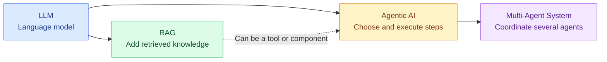
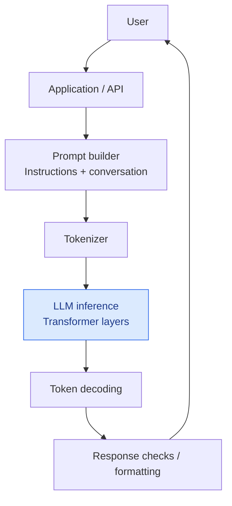
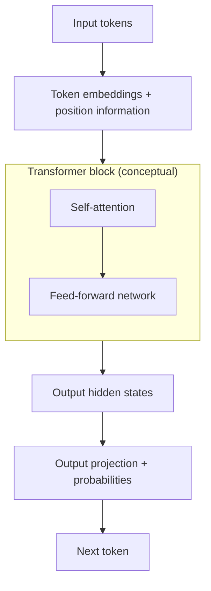
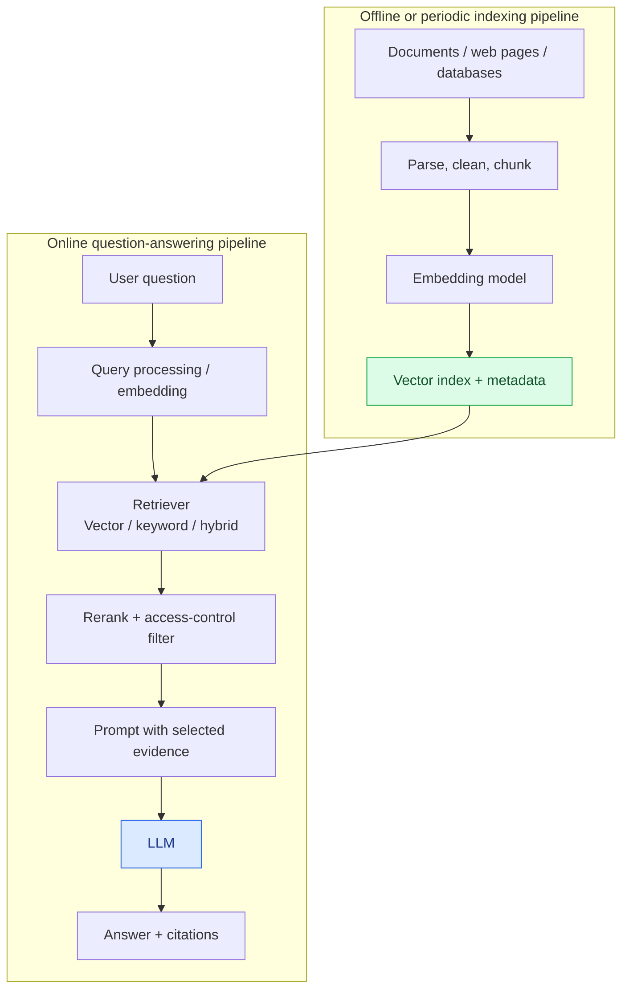
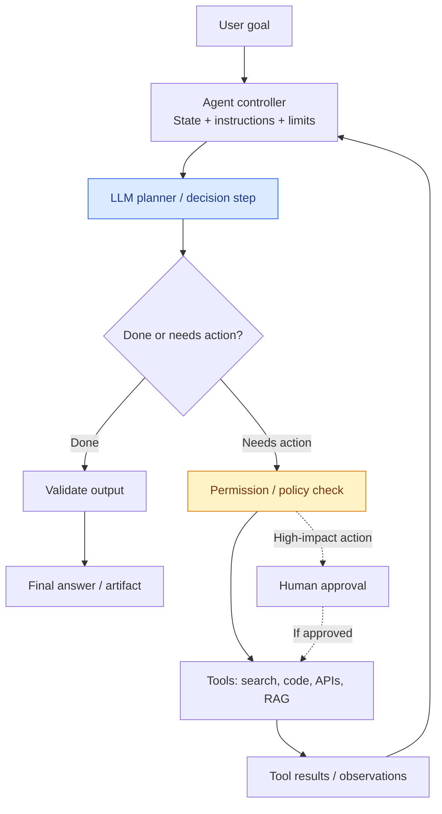
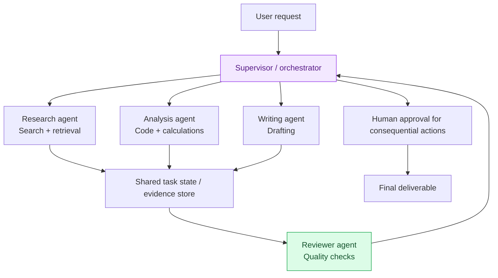
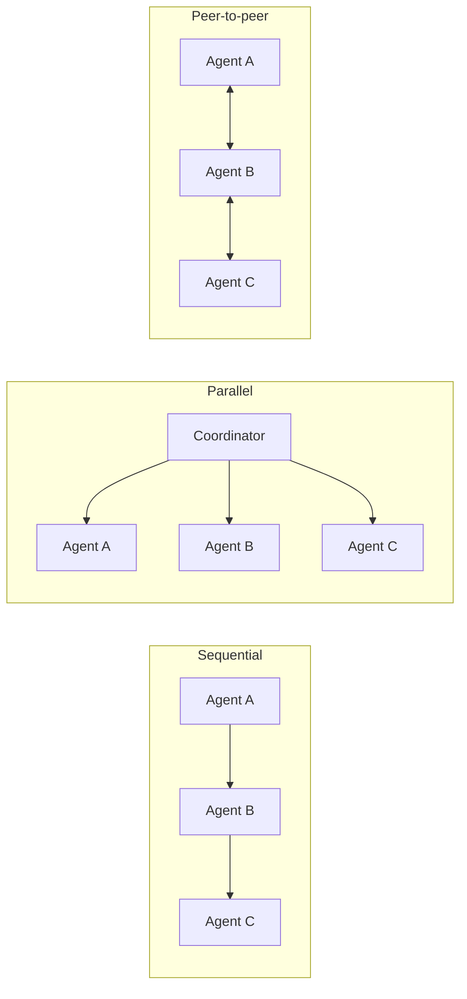
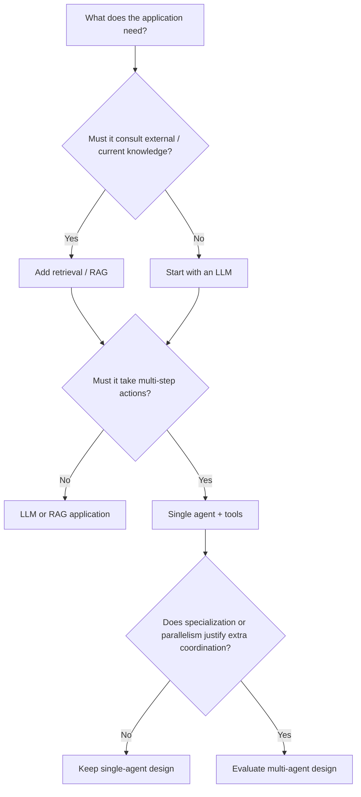
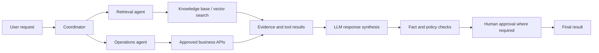

# LLM, RAG, Agentic AI & Multi-Agent Systems

> A research-oriented guide to the concepts, architectures, workflows, differences, and engineering trade-offs behind modern AI applications.

**Topics:** Large Language Models (LLMs) · Retrieval-Augmented Generation (RAG) · Agentic AI · Multi-Agent Systems  
**Format:** GitHub Markdown + Mermaid diagrams (rendered automatically by GitHub)

## Table of contents

1. [The big picture](#1-the-big-picture)
2. [What is an LLM?](#2-what-is-an-llm)
3. [What is RAG?](#3-what-is-rag)
4. [What is Agentic AI?](#4-what-is-agentic-ai)
5. [What is a Multi-Agent System?](#5-what-is-a-multi-agent-system)
6. [Side-by-side comparison](#6-side-by-side-comparison)
7. [Putting them together](#7-putting-them-together)
8. [Security, reliability, and evaluation](#8-security-reliability-and-evaluation)
9. [Research directions](#9-research-directions)
10. [References](#10-references)

## 1. The big picture

These terms describe **different layers of an AI system**, not four successive generations:

- **LLM** is a model that processes and generates language (and, for some models, other modalities).
- **RAG** is an application pattern that retrieves relevant external information to ground an LLM's response.
- **Agentic AI** is a system that uses a model and a control loop to pursue goals, decide next steps, and interact with tools or environments.
- **Multi-Agent System** coordinates multiple agents with specialized roles or capabilities.

> **Important:** RAG can work without agents; an agent can work without RAG; and multi-agent systems need not be based on LLMs. The diagrams below show common *LLM-based* implementations.

## 2. What is an LLM?

A **Large Language Model (LLM)** is a machine-learning model trained on large datasets to learn statistical patterns and relationships in tokens. Many modern LLMs use a **Transformer** neural-network architecture. During generation, the model predicts successive tokens conditioned on the input and previously generated tokens.

**Typical capabilities:** summarization, translation, question answering, code assistance, drafting, and classification. **Limitations:** hallucinations, finite context windows, knowledge gaps, bias, and errors on tasks requiring verified current facts.

### 2.1 Common LLM application architecture

### 2.2 Simplified Transformer block

*Diagram simplifies residual connections, normalization, attention masks, and architecture variants. Decoder-only LLMs typically apply causal attention.*

### 2.3 LLM training vs inference

| Phase | What happens | Main concern |
|---|---|---|
| Pretraining | Learns from large-scale training data | Data quality, compute, licensing |
| Post-training | Instruction tuning, preference or reinforcement-based optimization | Alignment, behavior, usefulness |
| Inference | Generates responses from prompts and context | Latency, cost, reliability |

## 3. What is RAG?

**Retrieval-Augmented Generation (RAG)** combines information retrieval with a generative model. Instead of relying only on model parameters, the application searches a knowledge source and inserts relevant passages into the model's context before producing an answer.

**Example:** An employee asks, “What is our company's leave policy?” A RAG application fetches the latest approved HR policy and drafts a source-grounded answer.

### 3.1 RAG architecture: two pipelines

**Key components:** document ingestion, parsing and chunking, embeddings, vector or keyword search, optional reranking, metadata/permission filters, prompt construction, LLM generation, and evidence-based citations.

### 3.2 Typical RAG workflow

1. Prepare and index trusted content, storing references to document IDs and versions.
2. Receive a question and retrieve potentially relevant passages.
3. Check permissions; optionally rerank and remove duplicates.
4. Place the best supporting passages into the LLM's context.
5. Generate a response with citations, and abstain where evidence is insufficient.

**Strengths:** updated information without full retraining, source traceability, use of private organizational content where authorized.  
**Weaknesses:** irrelevant retrieval, missing documents, stale indexes, context overflow, sensitive data leakage, and prompt injection in retrieved content.

> RAG **can reduce** unsupported answers; it does **not guarantee** factual correctness.

## 4. What is Agentic AI?

**Agentic AI** refers to applications that can pursue goals through **repeated decision-and-action steps**, rather than generating only one response. An LLM is often the decision-making component; a controller manages tool calls, state, feedback, budgets, and stop conditions.

**Example:** Given “Analyze this month's sales and draft a summary,” an agent may inspect authorized files, run calculations, review its output, and produce a report.

### 4.1 Single-agent architecture

### 4.2 Agent building blocks

| Part | Function |
|---|---|
| Goal and instructions | Define the task and boundaries |
| Model | Interpret requests and propose actions |
| Orchestrator / controller | Execute the loop and track state |
| Tools | Search, APIs, code, databases, or retrieval |
| Memory / state | Store intermediate observations and relevant context |
| Guardrails | Access limits, approval gates, budgets, validation |
| Evaluation | Check task completion, correctness, cost and safety |

**Distinguishing feature:** the system can iteratively select actions using feedback. A simple prompt template with an LLM is not necessarily an agent.

## 5. What is a Multi-Agent System?

A **Multi-Agent System (MAS)** is a system in which **multiple agents coordinate, communicate, or negotiate** to solve tasks. In modern LLM-based applications, agents may share a model or use different models and tools.

**Example:** A research workflow has one agent gathering sources, another analyzing them, and a third checking factual claims before a coordinator composes the final report.

### 5.1 Supervisor-based architecture

### 5.2 Other common coordination patterns

**Trade-offs:** Multi-agent designs can improve task specialization and parallelism, but introduce extra latency, token cost, coordination errors, duplicated work, and security complexity. One well-designed agent may be better for simpler tasks.

## 6. Side-by-side comparison

| Dimension | LLM application | RAG application | Single-agent application | Multi-agent application |
|---|---|---|---|---|
| Primary idea | Generate from context | Retrieve evidence before generation | Iterate using tools and feedback | Coordinate specialized agents |
| External information | Optional | Core component | Optional | Optional, often shared |
| Tool use | Optional | Usually retrieval | Often multiple tools | Tools distributed across agents |
| Planning / iteration | Not required | Not required | Common | Common and coordinated |
| Complexity | Low–medium | Medium | Medium–high | High |
| Main failure mode | Unsupported output | Bad or stale retrieval | Wrong tool action / loops | Coordination and cascading errors |
| Good first use | Drafting, summarization | Policy and document Q&A | Multi-step workflow | Complex decomposable work |

### Choosing an architecture

## 7. Putting them together

These techniques can be composed. For example, a customer-support workflow could use **RAG** to retrieve the approved support knowledge base, an **agent** to inspect an authorized order, and **multiple agents** only if research and verification benefit from separate roles.

*This is one illustrative architecture, not a mandatory design or standardized reference architecture.*

## 8. Security, reliability, and evaluation

### Core engineering safeguards

- Treat retrieved documents and tool outputs as **untrusted data**, not higher-priority instructions.
- Enforce permissions **before retrieval and before every tool action**.
- Use least-privilege credentials, allowlists, limits on retries/cost, and explicit stop conditions.
- Require human approval for destructive, financial, external-publishing, or other consequential actions.
- Track provenance: retrieved source, document version, agent/tool logs, and decisions.
- Evaluate on representative tasks before deployment; monitor drift and failures.

### Suggested evaluation metrics

| Architecture | Example metrics |
|---|---|
| LLM | Task accuracy, factuality, latency, cost, safety |
| RAG | Recall@k, retrieval precision, citation support, answer faithfulness |
| Agentic | Task completion, tool-call correctness, step count, intervention rate |
| Multi-agent | End-to-end success, handoff failures, coordination overhead, total cost |

## 9. Research directions

- **RAG:** hybrid retrieval, graph RAG, multimodal retrieval, grounding and provenance.
- **LLMs:** efficiency, longer-context reliability, model compression, robust evaluation.
- **Agentic AI:** secure tool use, planning under uncertainty, recoverability, human oversight.
- **Multi-agent systems:** communication protocols, agent specialization, coordination efficiency, failure containment.

## 10. References

1. Vaswani, A., et al. (2017). **Attention Is All You Need.** [arXiv:1706.03762](https://arxiv.org/abs/1706.03762). Introduces the Transformer architecture.
2. Lewis, P., et al. (2020). **Retrieval-Augmented Generation for Knowledge-Intensive NLP Tasks.** [arXiv:2005.11401](https://arxiv.org/abs/2005.11401). Foundational RAG paper.
3. Yao, S., et al. (2023). **ReAct: Synergizing Reasoning and Acting in Language Models.** [arXiv:2210.03629](https://arxiv.org/abs/2210.03629). Explores interleaved reasoning and tool-based actions.
4. Wu, Q., et al. (2024). **AutoGen: Enabling Next-Gen LLM Applications via Multi-Agent Conversation.** [arXiv:2308.08155](https://arxiv.org/abs/2308.08155). Discusses conversable, customizable multi-agent systems.

---

### Repository purpose

This repository is for **education and architectural research**. Examples are simplified to teach core concepts; production systems require additional engineering, privacy, security, observability, and evaluation.
